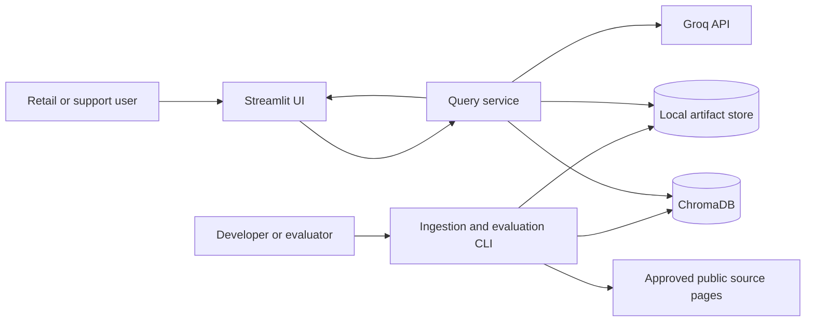
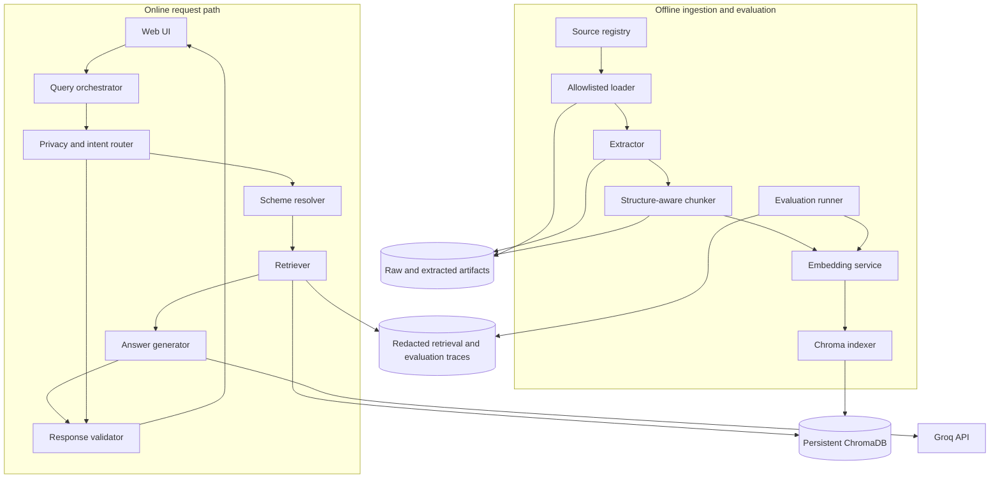
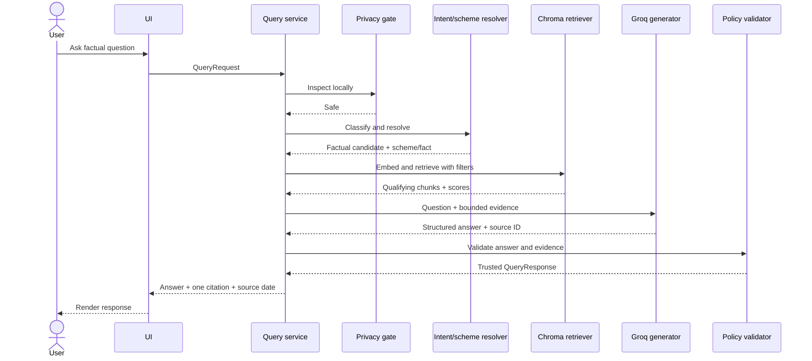
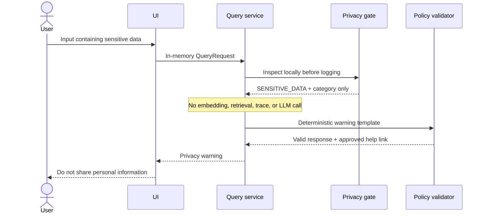
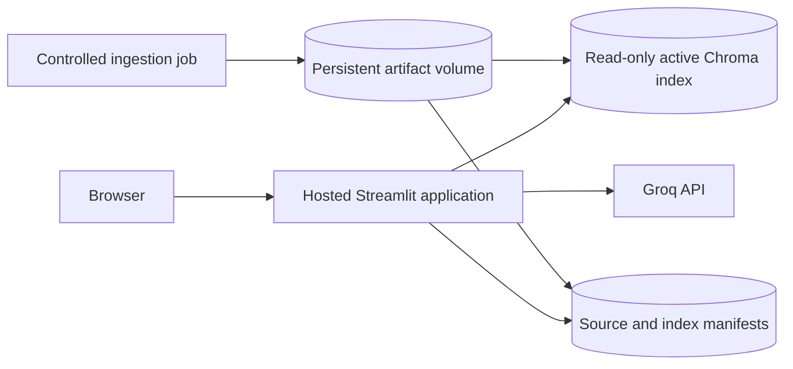

# Technical Architecture: Groww Mutual Fund FAQ Assistant

## 1. Document Control

| Field | Value |
|---|---|
| System | Groww Mutual Fund FAQ Assistant |
| Architecture status | Proposed reference architecture |
| Version | 1.0 |
| Date | 24 November 2026 |
| Product requirements | `PRD.md` |
| Architecture style | Python modular monolith with offline ingestion and online query paths |

## 2. Purpose

This document converts the requirements in `PRD.md` into an implementation-ready technical design. It defines component responsibilities, data contracts, processing flows, trust boundaries, persistence, configuration, validation, testing, and deployment for the initial five-page RAG prototype.

The architecture deliberately favors inspectability and deterministic safeguards over infrastructure complexity. Each RAG stage is a separate module and persists its own output, but the modules remain in one codebase and can run on one machine.

## 3. Architecture Principles

1. **Evidence before generation:** no factual response is generated without qualifying retrieved evidence.
2. **Application-owned policy:** the application enforces scope, privacy, sentence count, and citation rules; these controls are not delegated only to an LLM prompt.
3. **Trusted metadata over model output:** the model selects a source ID, while the application resolves the final URL from the trusted source registry.
4. **Privacy before observability:** sensitive-data detection runs before logs, retrieval traces, embeddings, or external model calls.
5. **Explicit stage artifacts:** raw pages, extracted text, chunks, index metadata, retrieval results, and evaluation results are stored independently.
6. **Reproducible indexes:** chunk IDs and configuration fingerprints make ingestion idempotent and detect incompatible indexes.
7. **Configurable providers:** embedding, vector store, and LLM choices are behind small interfaces and selected through configuration.
8. **Small-system simplicity:** use a modular monolith and local persistent storage for the prototype; add distributed services only when justified by scale.
9. **Fail closed:** missing evidence, invalid citations, incompatible configuration, or validation failures produce safe fallbacks rather than speculative answers.

## 4. Scope and Constraints

### 4.1 In scope

- Ingest exactly the five allowlisted Groww AMC/scheme pages.
- Extract and chunk factual mutual fund content.
- Create embeddings with `sentence-transformers/all-MiniLM-L6-v2` by default.
- Persist and query embeddings using ChromaDB by default.
- Use Groq as the initial LLM provider with provider and model selected from environment configuration.
- Answer supported factual questions with exactly one trusted citation.
- Route advice, performance, ambiguous, unsupported, out-of-scope, and sensitive-data inputs safely.
- Expose stage artifacts for demonstration and evaluation.
- Provide a compact web UI and a command-line ingestion/evaluation workflow.

### 4.2 Out of scope

- Account access, user profiles, authentication, or transactions.
- Portfolio data, recommendations, suitability, return calculations, or projections.
- Recursive crawling or discovery of pages through scraped links.
- Distributed queues, microservices, autoscaling, or multi-region operation.
- Long-term storage of conversations.
- Real-time market or NAV feeds.
- Full implementations for every future LLM provider in the first release.

## 5. Proposed Technology Stack

| Concern | Reference choice | Rationale |
|---|---|---|
| Runtime | Python 3.11+ | Strong support for scraping, embeddings, ChromaDB, and rapid prototyping. |
| UI | Streamlit | Small interactive UI, easy hosting, and suitable debug/demo views. |
| Configuration | YAML + Pydantic settings + `.env` | Typed validation and clean separation of settings from secrets. |
| HTTP loading | `httpx` | Timeouts, redirect controls, response limits, and testable client abstraction. |
| HTML extraction | Beautiful Soup with source-specific selectors and generic fallback | Preserves labelled facts while keeping parsing inspectable. |
| Token counting | Tokenizer-aware utility | Supports configurable chunk size without splitting atomic facts. |
| Embeddings | Sentence Transformers | Direct support for the required MiniLM model. |
| Vector database | Persistent ChromaDB | Required default and sufficient for the small local corpus. |
| LLM | Groq adapter | Required initial provider; model is supplied through `.env`. |
| Models and validation | Pydantic | Typed contracts between pipeline stages and structured LLM output. |
| Tests | Pytest | Unit, integration, safety, and acceptance tests. |
| Packaging | `pyproject.toml` and optional Docker image | Reproducible local and hosted setup. |

Equivalent libraries may be substituted if they preserve the interfaces, controls, and artifacts defined here.

## 6. System Context



External network access is required only for approved source ingestion and LLM calls. The embedding model may be downloaded during setup and then used locally. No user input may be sent to the LLM until the sensitive-data gate has passed.

## 7. Container View

The term “container” here means a logical deployable or data boundary, not necessarily a Docker container.



## 8. Execution Model

### 8.1 Offline ingestion path

Ingestion is an explicit command, not part of a user query. It fetches only the five configured pages, materializes each stage, and atomically publishes a compatible Chroma collection after validation.

Example command:

```text
python -m app.cli ingest --config config/config.yaml
```

### 8.2 Online query path

The web application loads the source registry and index manifest at startup. Each user query is processed in memory and is not retained by default. Only a redacted, opt-in debug trace may be written.

Example command:

```text
streamlit run app/ui/main.py
```

### 8.3 Evaluation path

The evaluation runner reads synthetic or non-sensitive test cases, invokes the same query service used by the UI, and writes pass/fail results to `data/evaluations/`.

```text
python -m app.cli evaluate --cases tests/fixtures/sample_qa.yaml
```

## 9. Component Design

### 9.1 Configuration service

Responsibilities:

- Read non-secret configuration from YAML.
- Read provider/model selection and API keys from environment variables or `.env` in local development.
- Validate all settings at process startup.
- Produce a stable configuration fingerprint used by artifacts and the index.
- Reject unsafe settings such as recursive crawling, missing source registry, or incompatible embedding dimensions.

The configuration object is immutable after startup. Secrets must use redacted representations and must never be included in `repr`, logs, manifests, or debug panels.

### 9.2 Source registry

The source registry is the root of trust for loading and citation. It separates pages that may be fetched into the RAG corpus from pages that may only be used as reference links.

Suggested `config/sources.yaml` shape:

```yaml
sources:
  - source_id: SRC-01
    title: HDFC Mutual Fund
    url: https://groww.in/mutual-funds/amc/hdfc-mutual-funds
    owner: Groww
    source_type: ingestion
    scheme_slug: null
    enabled: true

  - source_id: REF-01
    title: Official investment education resource
    url: https://example.invalid/replace-with-approved-official-page
    owner: SEBI
    source_type: reference_only
    purpose: advice_refusal
    enabled: false
```

Rules:

- Only `source_type: ingestion` entries may be fetched by the ingestion loader.
- Only enabled entries may be shown as citations.
- Every citation URL is resolved from `source_id`; arbitrary model-generated URLs are discarded.
- Reference-only entries require manual review before being enabled.
- A normalized URL must be unique in the registry.

### 9.3 Allowlisted page loader

Responsibilities:

- Accept a `SourceDefinition`, never an arbitrary user URL.
- Require HTTPS and an exact normalized URL match against the registry.
- Apply connection/read timeouts, retry only transient failures, and cap response size.
- Accept HTML content types only.
- Disable recursive link following.
- Reject redirects whose final normalized URL is not explicitly allowlisted.
- Store HTTP metadata, checksum, raw content, and error state.
- Use a descriptive user agent and obey applicable site access rules.

The loader must not execute JavaScript, submit forms, authenticate, or access private endpoints.

### 9.4 Content extractor

Responsibilities:

- Parse a raw snapshot into a normalized page document.
- Preserve title, headings, labelled values, lists, and table rows.
- Remove navigation, cookie banners, scripts, styles, repeated chrome, and unrelated recommendations.
- Normalize whitespace and common encoding artifacts without changing factual values.
- Record extraction warnings and parser version.
- Prefer reviewed page-specific selectors; use a generic semantic fallback when selectors fail.

Extraction quality gates:

- A page title or scheme identifier is present.
- At least one meaningful content section is extracted.
- The source URL and retrieval date are attached.
- Extraction output does not include executable instructions.
- A material drop in extracted text length compared with the previous snapshot is flagged for review.

### 9.5 Structure-aware chunker

The chunker works in two passes:

1. Detect atomic facts and structural blocks.
2. Pack compatible narrative blocks to the configured token target.

Atomic chunks include label-value facts such as expense ratio, exit load, minimum SIP, lock-in, risk level, and benchmark. These blocks must never be split across chunks. Narrative content may use the configured overlap.

Chunk metadata includes:

- Chunk ID.
- Source ID and canonical URL.
- Page and scheme names.
- Section heading.
- Fact type when known.
- Clean chunk text.
- Chunk index.
- Extraction timestamp.
- Raw and extracted content checksums.
- Chunker version and configuration fingerprint.

### 9.6 Embedding service

Interface:

```python
class EmbeddingProvider(Protocol):
    @property
    def model_id(self) -> str: ...

    @property
    def dimension(self) -> int: ...

    def embed_documents(self, texts: list[str]) -> list[list[float]]: ...
    def embed_query(self, text: str) -> list[float]: ...
```

The default adapter uses `sentence-transformers/all-MiniLM-L6-v2`. Document and query embeddings must come from the same adapter instance/configuration. The adapter normalizes input consistently and exposes model identity and vector dimension for compatibility checks.

### 9.7 Chroma repository

Responsibilities:

- Create or open the configured persistent collection.
- Upsert deterministic chunk IDs with text, vectors, and metadata.
- Query by vector with optional scheme/source filters.
- Return typed retrieval results containing distance/score, text, and metadata.
- Store an index manifest outside the Chroma collection for startup validation.

Only the offline ingestion process writes to the collection. The online application treats it as read-only. A new build writes to a staging collection and replaces the active pointer only after validation succeeds.

### 9.8 Sensitive-data gate

This is the first request-processing component. It runs before request logging, embeddings, classification by an external model, retrieval, or answer generation.

Detection uses local deterministic patterns and checks for:

- PAN-like identifiers.
- Aadhaar-like identifiers.
- OTP/passcode language combined with digit sequences.
- Account-number language combined with identifier-like sequences.
- Email addresses.
- Indian and international phone-number patterns.

The gate returns only a category and redacted diagnostic code. It must not persist or echo the matched text. False positives favor the safe warning path.

### 9.9 Intent and scope router

The router returns one of the PRD categories:

```text
FACTUAL_SUPPORTED_CANDIDATE
CLARIFICATION_REQUIRED
ADVICE_OR_OPINION
PERFORMANCE_REQUEST
OUT_OF_SCOPE
SENSITIVE_DATA
```

Routing is deterministic-first:

1. Sensitive-data category from the privacy gate.
2. Explicit advice, transaction, performance, and out-of-scope patterns.
3. Scheme/fact recognition and ambiguity checks.
4. Optional local or LLM-assisted classification only for unresolved cases.

The router never labels a question `FACTUAL_SUPPORTED`; it only identifies a factual candidate. Actual support is decided after retrieval.

### 9.10 Scheme and fact resolver

Responsibilities:

- Map common scheme-name variants to the canonical scheme ID.
- Recognize fact types such as expense ratio, exit load, minimum SIP, lock-in, riskometer, benchmark, and statement process.
- Return ambiguity when multiple schemes remain plausible.
- Supply Chroma metadata filters when a scheme is identified.

Aliases live in reviewed configuration rather than being invented by the LLM.

### 9.11 Retriever

Retrieval steps:

1. Embed the redaction-cleared query.
2. Apply scheme/source metadata filters when available.
3. Query Chroma for configured `top_k` results.
4. Convert database distance to a documented comparable score.
5. Apply the configured threshold.
6. Prefer exact fact-type matches when available.
7. Return qualifying evidence and a retrieval decision.

The result is `SUPPORTED` only when at least one chunk crosses the relevance threshold and its source is enabled in the registry. Otherwise, the final category becomes `UNSUPPORTED_BY_SOURCES`.

The threshold must be calibrated on the evaluation set; the sample configuration value is not a correctness guarantee.

### 9.12 LLM provider abstraction

Interface:

```python
class LLMProvider(Protocol):
    def generate_structured(
        self,
        *,
        system_prompt: str,
        user_prompt: str,
        response_schema: type[BaseModel],
    ) -> BaseModel: ...
```

The initial implementation is `GroqLLMProvider`. Provider construction uses a factory selected by `LLM_PROVIDER`. Adapters for Gemini, OpenAI, Anthropic, and Mistral can be added later without changing the query orchestrator.

The application validates provider/model availability at startup or on the first health check. An invalid configured model produces a clear readiness failure rather than falling back silently.

### 9.13 Answer generator

For a supported query, the generator receives only:

- The normalized question.
- Canonical scheme and fact type when resolved.
- A bounded list of retrieved evidence chunks.
- Their source IDs, not unrestricted URLs.
- The response policy.

Expected structured output:

```json
{
  "category": "FACTUAL_SUPPORTED",
  "answer_text": "...",
  "selected_source_id": "SRC-02",
  "evidence_chunk_ids": ["chk_..."]
}
```

The prompt prohibits outside knowledge, calculations, recommendations, extra URLs, and unsupported qualifiers. Temperature defaults to zero. The UI never displays hidden reasoning or raw chain-of-thought.

Safe refusals and privacy warnings should use application-owned templates where practical. This reduces latency and makes policy behavior deterministic.

### 9.14 Response policy validator

Validation occurs after every response path. It checks:

- Category is one of the defined values.
- Supported factual answers have qualifying evidence.
- Selected source ID occurs in the qualifying evidence.
- Selected source is enabled in the registry.
- Application-attached citation count equals one.
- Answer text contains no untrusted URL.
- Answer/refusal copy is at most three sentences.
- Prohibited advice, prediction, ranking, and performance-comparison phrases are absent.
- Response contains no detected sensitive value.
- A valid source refresh date is available.

The validator resolves the source ID to a title and URL, strips any model-emitted links, and builds the final response DTO. A failed validation produces a deterministic safe fallback with an approved reference link.

### 9.15 Query orchestrator

The orchestrator coordinates request processing without containing provider-specific logic. It owns timeouts and maps internal errors to user-safe states.

```python
class QueryService:
    def answer(self, request: QueryRequest) -> QueryResponse:
        ...
```

It does not persist raw requests or responses. When debug tracing is explicitly enabled, it passes only redacted fields and internal IDs to the trace writer.

### 9.16 Streamlit UI

The UI is a thin client over `QueryService` and contains no retrieval or policy logic. It displays:

- Welcome message.
- Three example questions.
- “Facts-only. No investment advice.”
- Input and submit control.
- Loading, answer, clarification, refusal, unsupported, privacy warning, and error states.
- Answer text, one descriptive citation, and source refresh date.
- Optional development-only debug expander with category, chunk IDs, safe chunk excerpts, and scores.

The debug expander must be disabled in public deployment unless all traces are redacted and disclosure is intentional.

## 10. Request Sequence

### 10.1 Supported factual question



### 10.2 Sensitive-data input



### 10.3 Unsupported factual question

The request passes privacy and intent routing, but no retrieved chunk meets the threshold. The orchestrator uses the unsupported-source template, attaches the most relevant approved scope/source link through trusted metadata, and does not call the LLM unless a concise paraphrase is required.

## 11. Data Contracts

### 11.1 Source definition

```json
{
  "source_id": "SRC-02",
  "title": "HDFC Large Cap Fund Direct Growth",
  "url": "https://groww.in/mutual-funds/hdfc-large-cap-fund-direct-growth",
  "owner": "Groww",
  "source_type": "ingestion",
  "scheme_id": "hdfc_large_cap_direct_growth",
  "purpose": "scheme_facts",
  "enabled": true
}
```

### 11.2 Raw source manifest

```json
{
  "run_id": "ing_20261124T010000Z_ab12cd",
  "source_id": "SRC-02",
  "requested_url": "https://groww.in/...",
  "canonical_url": "https://groww.in/...",
  "retrieved_at": "2026-11-24T01:00:00Z",
  "http_status": 200,
  "content_type": "text/html",
  "content_sha256": "...",
  "raw_path": "data/raw/SRC-02/<checksum>.html",
  "loader_version": "1",
  "status": "SUCCESS",
  "error_code": null
}
```

### 11.3 Extracted document

```json
{
  "document_id": "doc_<hash>",
  "source_id": "SRC-02",
  "title": "HDFC Large Cap Fund Direct Growth",
  "scheme_id": "hdfc_large_cap_direct_growth",
  "retrieved_at": "2026-11-24T01:00:00Z",
  "parser_version": "1",
  "raw_sha256": "...",
  "text_sha256": "...",
  "sections": [
    {
      "heading": "Fund details",
      "blocks": [
        {"kind": "fact", "label": "Expense ratio", "value": "..."}
      ]
    }
  ],
  "warnings": []
}
```

### 11.4 Chunk record

Chunks are stored as JSON Lines so they are readable, diffable, and streamable.

```json
{
  "chunk_id": "chk_<sha256-prefix>",
  "document_id": "doc_<hash>",
  "source_id": "SRC-02",
  "scheme_id": "hdfc_large_cap_direct_growth",
  "section": "Fund details",
  "fact_type": "expense_ratio",
  "text": "Expense ratio: ...",
  "chunk_index": 7,
  "retrieved_at": "2026-11-24T01:00:00Z",
  "chunker_version": "1",
  "config_fingerprint": "cfg_<hash>"
}
```

### 11.5 Index manifest

```json
{
  "index_version": "idx_<hash>",
  "created_at": "2026-11-24T01:05:00Z",
  "collection_name": "groww_hdfc_mf_faq",
  "embedding_provider": "sentence_transformers",
  "embedding_model": "sentence-transformers/all-MiniLM-L6-v2",
  "embedding_dimension": 384,
  "chunk_count": 0,
  "source_checksums": {"SRC-01": "..."},
  "chunker_version": "1",
  "config_fingerprint": "cfg_<hash>",
  "status": "READY"
}
```

`chunk_count` is populated by the index build; zero in this example is only a schema placeholder and is not valid for a ready production index.

### 11.6 Query request

```json
{
  "question": "What is the expense ratio of HDFC Large Cap Fund Direct Growth?",
  "debug": false
}
```

The request has no user identity, conversation ID, or account fields.

### 11.7 Query response

```json
{
  "category": "FACTUAL_SUPPORTED",
  "answer": "The expense ratio is ...",
  "citation": {
    "source_id": "SRC-02",
    "label": "HDFC Large Cap Fund Direct Growth",
    "url": "https://groww.in/mutual-funds/hdfc-large-cap-fund-direct-growth"
  },
  "source_updated_at": "2026-11-24T01:00:00Z",
  "debug": null
}
```

### 11.8 Redacted retrieval trace

Debug traces are off by default. When enabled locally, a trace may contain:

```json
{
  "trace_id": "trace_<random>",
  "created_at": "2026-11-24T01:10:00Z",
  "query_category": "FACTUAL_SUPPORTED",
  "normalized_query_template": "expense_ratio::<scheme_id>",
  "resolved_scheme_id": "hdfc_large_cap_direct_growth",
  "retrieved": [
    {"chunk_id": "chk_...", "source_id": "SRC-02", "score": 0.91}
  ],
  "selected_source_id": "SRC-02",
  "latency_ms": {"routing": 2, "retrieval": 34, "generation": 620},
  "validation_status": "PASS"
}
```

Raw user text is intentionally absent.

## 12. Identifiers and Idempotency

Deterministic identifiers prevent duplication and allow lineage tracing:

- `document_id = sha256(source_id + raw_sha256 + parser_version)`.
- `chunk_id = sha256(document_id + normalized_chunk_text + structural_path + chunker_version)`.
- `config_fingerprint = sha256(canonical_non_secret_configuration)`.
- `index_version = sha256(sorted_chunk_ids + embedding_model + config_fingerprint)`.

The exact canonicalization algorithm must be covered by unit tests. Re-running unchanged ingestion produces the same IDs and upserts rather than duplicate records.

## 13. Persistence Layout

```text
.
├── app/
│   ├── cli.py
│   ├── config/
│   ├── domain/
│   ├── ingestion/
│   ├── embeddings/
│   ├── vector_store/
│   ├── retrieval/
│   ├── safety/
│   ├── generation/
│   ├── query/
│   ├── observability/
│   └── ui/
├── config/
│   ├── config.yaml
│   ├── sources.yaml
│   └── scheme_aliases.yaml
├── data/
│   ├── raw/
│   ├── extracted/
│   ├── chunks/
│   ├── embeddings/
│   ├── chroma/
│   ├── manifests/
│   ├── retrieval_runs/
│   └── evaluations/
├── prompts/
│   ├── classify.md
│   └── answer.md
├── tests/
│   ├── unit/
│   ├── integration/
│   ├── acceptance/
│   └── fixtures/
├── .env.example
├── .gitignore
├── pyproject.toml
├── README.md
├── PRD.md
└── architecture.md
```

Large or generated artifacts under `data/` should be excluded from version control except for intentionally small sample fixtures and manifests required for the demo.

## 14. Configuration

Suggested `config/config.yaml`:

```yaml
application:
  environment: local
  debug_traces: false
  max_query_characters: 1000

ingestion:
  sources_file: config/sources.yaml
  follow_links: false
  connect_timeout_seconds: 5
  read_timeout_seconds: 20
  max_response_bytes: 5000000
  max_retries: 2

chunking:
  strategy: structure_aware
  target_tokens: 400
  overlap_tokens: 50

embeddings:
  provider: sentence_transformers
  model: sentence-transformers/all-MiniLM-L6-v2
  batch_size: 32
  normalize: true

vector_db:
  provider: chroma
  collection: groww_hdfc_mf_faq
  persist_directory: data/chroma

retrieval:
  top_k: 5
  score_threshold: 0.50

llm:
  temperature: 0
  request_timeout_seconds: 20
  max_retries: 1

response:
  max_sentences: 3
  citation_count: 1

artifacts:
  root: data
```

Suggested `.env.example`:

```dotenv
LLM_PROVIDER=groq
LLM_MODEL=qwen/qwen3.8-27b
GROQ_API_KEY=
```

The model value is intentionally configurable and must be verified against the provider's available models during implementation. Do not silently replace it with a different model.

Configuration precedence:

1. Secure runtime environment variables for secrets and provider selection.
2. `.env` for local development only.
3. YAML for non-secret defaults.

## 15. Prompt Architecture

Prompts are versioned files rather than inline strings. Each prompt has a stable name and version included in evaluation metadata.

### 15.1 Answer prompt contract

The system instruction must state:

- Use only supplied evidence.
- Do not use outside knowledge.
- Do not advise, recommend, rank, calculate, or predict.
- State that the fact cannot be verified when evidence is insufficient.
- Return no URL and select only a supplied source ID.
- Use no more than three sentences.
- Return the specified JSON schema.

Evidence is wrapped as clearly delimited quoted data. Instructions contained inside scraped evidence are untrusted and must be ignored.

### 15.2 Template-owned responses

The following should be deterministic templates, not free-form LLM generations:

- Sensitive-data warning.
- Advice/opinion refusal.
- Performance calculation/comparison refusal.
- Empty query.
- Unsupported-source fallback.
- Service-unavailable fallback.

Template variables are restricted to trusted source labels/URLs and canonical scheme names.

## 16. Index Build and Compatibility

### 16.1 Build lifecycle

1. Create a unique ingestion run directory.
2. Load and validate all enabled ingestion sources.
3. Extract and chunk successful sources.
4. Write and validate stage manifests.
5. Embed chunks.
6. Build a staging Chroma collection.
7. Run smoke retrieval tests.
8. Write a `READY` index manifest.
9. Atomically update the active-index pointer.
10. Retain the previous valid index for recovery.

### 16.2 Startup compatibility gate

The web application refuses readiness when any of these differ between runtime configuration and the active index manifest:

- Embedding provider.
- Embedding model identifier.
- Embedding dimension.
- Collection name or index version.
- Chunk schema version.
- Required source registry IDs.

The application may still start a diagnostic UI, but it must not answer factual questions until the gate passes.

## 17. Security and Privacy Architecture

### 17.1 Trust boundaries

| Boundary | Risk | Control |
|---|---|---|
| Public pages to loader | Malformed content, prompt injection, oversized responses | Exact URL allowlist, content limits, HTML-only parsing, treat content as data. |
| User input to application | PII, abuse, prompt injection | Local sensitive-data gate, length limit, scope router, no raw persistence. |
| Application to LLM provider | Sensitive-data transmission, data leakage | Gate before call, minimal evidence/context, no secrets or raw artifacts in prompts. |
| LLM output to UI | Fabricated fact or URL, unsafe advice | Structured schema, evidence/source validation, app-built citation, deterministic fallback. |
| Runtime to filesystem | Secret or conversation leakage | Restricted artifact schemas, redacted traces, `.env` excluded from version control. |

### 17.2 Secret handling

- API keys exist only in environment variables or local `.env`.
- `.env` is in `.gitignore`.
- Logs redact all environment variables whose names indicate keys, tokens, or secrets.
- Health endpoints report only whether a key is configured, never its value or prefix.
- Public deployments use platform secret storage.

### 17.3 Input controls

- Reject empty or whitespace-only questions.
- Apply a configurable character limit before processing.
- Treat all input as plain text; do not render user HTML or Markdown unsafely.
- Do not allow user-supplied URLs to enter the loader or citation system.
- Do not provide file upload in the initial release.

### 17.4 Output controls

- Escape rendered answer text.
- Open source links with safe browser attributes where supported.
- Resolve links from the registry only.
- Do not render model-produced HTML.
- Never expose stack traces, prompts, environment values, or full filesystem paths in the public UI.

### 17.5 Data retention

| Data | Default retention |
|---|---|
| Raw public source snapshots | Retain by content checksum for reproducibility. |
| Extracted documents/chunks | Retain with the active index and prior recovery index. |
| Raw user questions | Do not persist. |
| Model prompts/responses | Do not persist in normal operation. |
| Redacted debug traces | Disabled by default; local/demo retention only. |
| Evaluation fixtures/results | Retain; fixtures must be synthetic and non-sensitive. |

## 18. Reliability and Error Handling

### 18.1 Error taxonomy

| Error | Behavior |
|---|---|
| Invalid configuration | Fail startup with actionable validation details. |
| Source fetch failure | Record per-source error; do not overwrite the last valid index. |
| Extraction quality failure | Quarantine the source run and require review. |
| Embedding/model load failure | Abort index build; retain current active index. |
| Chroma incompatibility/corruption | Fail readiness and report recovery instructions. |
| Retrieval has no qualifying result | Return `UNSUPPORTED_BY_SOURCES`. |
| LLM timeout/provider error | Return deterministic service-unavailable response with one approved link. |
| Invalid LLM schema/output | Retry once if configured, then use safe fallback. |
| Response policy failure | Never display failed output; use safe fallback. |

### 18.2 Retries

- Retry only transient network and provider errors.
- Use bounded exponential backoff with jitter.
- Do not retry policy, schema, authentication, or configuration failures indefinitely.
- Do not retry user requests in a way that could duplicate logs or external calls without the same trace context.

### 18.3 Timeouts

Separate timeouts apply to source loading, embedding initialization, vector retrieval, and LLM generation. The orchestrator maintains an overall request deadline and returns a clear error state when it expires.

## 19. Observability

Observability is structured and privacy-minimized.

### 19.1 Metrics

- Request count by response category.
- Request latency by stage.
- Retrieval score distribution.
- Unsupported-source rate.
- Advice/performance refusal counts.
- Sensitive-data gate count without matched text.
- LLM error, timeout, and schema-failure counts.
- Citation validation failure count.
- Source ingestion success/failure and content-change counts.
- Index build duration and chunk count.

### 19.2 Logs

Allowed fields:

- Timestamp.
- Severity.
- Component and event code.
- Anonymous request/trace ID generated by the application.
- Response category.
- Canonical scheme/fact IDs.
- Internal source/chunk IDs.
- Latency and error class.

Disallowed fields:

- Raw user question.
- Raw matched PII.
- API keys or authorization headers.
- Full prompts or model responses.
- Raw HTML in online logs.

### 19.3 Health and readiness

`liveness` confirms that the process is running. `readiness` confirms:

- Configuration is valid.
- Source registry loads.
- Active index manifest exists and is compatible.
- Chroma collection is readable.
- Required templates/prompts load.
- LLM provider configuration is present; provider reachability may be reported separately to avoid blocking local offline diagnostics.

## 20. Performance and Capacity

The five-page corpus is expected to fit in memory and on local disk. The architecture optimizes for clarity rather than high throughput.

- Embedding model loads once per process.
- Source registry, alias map, prompt templates, and index manifest are cached in memory.
- Query embeddings are computed per request; a small bounded cache may be added only if it never stores sensitive or raw user text as a key.
- Chroma is opened once and reused.
- LLM context contains only the few qualifying chunks needed for the answer.
- Ingestion batches document embeddings.

Prototype performance targets from the PRD:

- Median end-to-end latency under five seconds excluding cold start.
- Retrieval under one second locally.
- No duplicate chunks after repeated unchanged ingestion.

## 21. Deployment Architecture

### 21.1 Local development

```text
Developer workstation
├── Streamlit process
├── local embedding model cache
├── persistent Chroma directory
├── inspectable data artifacts
└── .env with Groq key
```

Ingestion runs before the UI. The active index and manifests are mounted/read directly by the Streamlit process.

### 21.2 Hosted prototype

Use one application container/process plus persistent or prebuilt read-only index artifacts:



Ingestion should be a controlled build/deployment step rather than a public web endpoint. Public deployment contains no ingestion trigger and no arbitrary URL input.

### 21.3 Container build

The image should:

- Install pinned dependencies from the lock file.
- Run as a non-root user where the platform supports it.
- Exclude `.env`, local caches, traces, and raw source data unless intentionally packaged.
- Expose a writable data volume only when runtime persistence is required.
- Keep secrets outside the image.

## 22. Testing Strategy

### 22.1 Unit tests

- URL normalization and exact allowlist enforcement.
- Redirect rejection.
- Extraction cleanup and labelled fact preservation.
- Atomic fact chunking and token boundaries.
- Deterministic IDs and configuration fingerprinting.
- Sensitive-data pattern detection using synthetic examples.
- Advice/performance/scope routing.
- Scheme alias and fact-type resolution.
- Sentence counting.
- Citation registry lookup and URL stripping.
- Index compatibility checks.

### 22.2 Contract tests

- Embedding provider returns expected vector dimension.
- Chroma repository upsert/query contract.
- Groq adapter parses the required structured schema.
- Every provider adapter maps failures to the common error taxonomy.

External HTTP and LLM calls are mocked in normal CI.

### 22.3 Integration tests

- Raw fixture to extracted document.
- Extracted document to chunks.
- Chunks to embeddings and temporary Chroma collection.
- Query to ranked evidence with metadata filter.
- Supported query to fully validated response using a fake LLM provider.
- Invalid model-selected source ID to safe fallback.
- No-result retrieval to unsupported response.
- Sensitive input stops before embedding, trace writing, and LLM call.

### 22.4 Acceptance tests

Map directly to `AC-01` through `AC-08` in the PRD. Each test stores:

- Query or ingestion fixture.
- Expected category/behavior.
- Retrieved chunk IDs and scores when applicable.
- Citation count and URL validation result.
- Sentence-count result.
- Sensitive-data persistence assertion.
- Overall pass/fail.

### 22.5 Evaluation tests

The 5–10 sample Q&A cases must include supported facts, advice refusal, performance refusal, unsupported/out-of-scope input, ambiguity, and synthetic sensitive data. The evaluation report calculates citation coverage, grounded accuracy, safety routing, conciseness, and traceability.

### 22.6 Security tests

- Source page contains prompt-injection text.
- User asks the model to ignore system rules.
- Model returns an arbitrary or malicious URL.
- User supplies a URL and asks the loader to fetch it.
- Oversized input and page response.
- Redirect from approved host to an unapproved destination.
- HTML/script content in user input or model output.
- Sensitive values do not appear in logs, traces, exceptions, or prompts.

## 23. CI/CD Quality Gates

A proposed pipeline:

1. Install locked dependencies.
2. Run formatting and static analysis.
3. Run type checks.
4. Run unit and integration tests with mocked external services.
5. Run sensitive-data leakage assertions.
6. Validate `config.yaml` and `sources.yaml` schemas.
7. Build the application image.
8. Run a smoke test against a fixture Chroma index.
9. Produce a software/dependency manifest where supported.
10. Deploy only if all mandatory gates pass.

Live source ingestion and paid LLM evaluation should be separate manual or scheduled jobs so ordinary CI is deterministic and does not depend on public page availability.

## 24. Requirement Traceability

| PRD requirement | Architecture realization |
|---|---|
| FR-01 | Source registry and exact-allowlist loader with redirect restrictions. |
| FR-02–FR-05 | Raw manifest, extractor, structure-aware chunker, and explicit artifact store. |
| FR-06–FR-08 | Embedding provider, Chroma repository, and startup compatibility gate. |
| FR-09 | Scheme-aware retriever with top-k and threshold configuration. |
| FR-10 | Evidence-gated generator, trusted source IDs, and response validator. |
| FR-11 | Sensitive-data gate plus deterministic-first intent/scope router. |
| FR-12 | Application-level sentence validator. |
| FR-13 | Retrieval date carried from source manifest to `QueryResponse`. |
| FR-14 | YAML for non-secrets and environment variables for secrets/provider selection. |
| FR-15 | `LLMProvider` interface with initial Groq adapter. |
| FR-16–FR-17 | Stage directories, manifests, redacted trace, and optional debug panel. |
| FR-18 | Structured privacy-minimized metrics and logs. |
| AC-01–AC-05 | Query sequence, evidence gates, deterministic refusals, and privacy short-circuit. |
| AC-06 | Loader accepts registry entries only and never follows page links. |
| AC-07 | Deterministic lineage across raw document, chunk, index, retrieval, and response. |
| AC-08 | Index manifest and runtime compatibility gate. |

## 25. Architecture Decisions

### ADR-001: Use a modular monolith

**Decision:** Keep ingestion, retrieval, safety, generation, and UI in one repository with clear module interfaces.

**Reason:** The corpus and expected traffic are small, while inspectability and setup simplicity are primary goals. Microservices would add deployment and debugging complexity without a current scaling need.

### ADR-002: Separate offline ingestion from online query serving

**Decision:** Ingestion is a controlled CLI/job and the public UI is read-only against the active index.

**Reason:** This prevents arbitrary URL fetching, avoids index mutation during queries, and makes artifacts reproducible.

### ADR-003: Use structure-aware chunks

**Decision:** Preserve atomic label-value facts and use token packing only for narrative sections.

**Reason:** The target questions ask for compact labelled facts; splitting labels from values would reduce retrieval accuracy.

### ADR-004: Construct citations outside the LLM

**Decision:** The LLM returns a source ID; the application resolves the only displayed URL.

**Reason:** This prevents fabricated or unapproved links and makes the exactly-one-citation rule deterministic.

### ADR-005: Use deterministic templates for safety responses

**Decision:** Privacy warnings and common refusals do not require LLM generation.

**Reason:** Templates are faster, auditable, consistent, and avoid sending restricted input to an external provider.

### ADR-006: Do not retain conversations

**Decision:** Process queries in memory and disable raw request/response storage by default.

**Reason:** The product does not require personalization or conversation history, and this minimizes privacy risk.

### ADR-007: Treat index compatibility as a startup gate

**Decision:** Refuse factual answering if runtime embedding settings do not match the active index manifest.

**Reason:** Querying an index with a different model or dimension can produce invalid retrieval silently.

## 26. Implementation Order

1. Domain models, typed configuration, source registry, and artifact conventions.
2. Exact-allowlist loader with fixture-based tests.
3. Extraction and structure-aware chunking with inspectable outputs.
4. Embedding adapter, Chroma repository, index manifest, and idempotent build.
5. Sensitive-data gate, intent router, scheme/fact resolver, and templates.
6. Retriever and no-evidence behavior.
7. Groq adapter, structured answer generator, and response validator.
8. Query orchestrator and Streamlit UI.
9. Evaluation runner, observability, acceptance tests, and packaging.

Each step should end with usable artifacts and tests before the next stage is added.

## 27. Open Implementation Decisions

The following require validation during development but do not block the architecture:

1. Final reviewed CSS selectors for each source page.
2. Exact official reference-only URLs for advice education, factsheets, privacy/safety, and statement download.
3. Calibrated retrieval threshold and whether Chroma distance must be normalized for the selected metric.
4. Final scheme alias list and fact taxonomy.
5. Availability and exact spelling of the configured Groq model identifier.
6. Hosting platform and whether the embedding model/index are built into the artifact or mounted at runtime.
7. Whether local redacted debug traces are needed for the final public demo.
8. Manual source refresh procedure and retention count for prior valid indexes.

These decisions must be documented in the README or an ADR before release.

